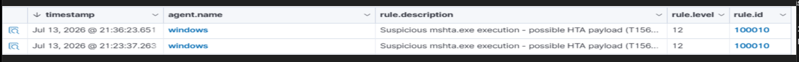
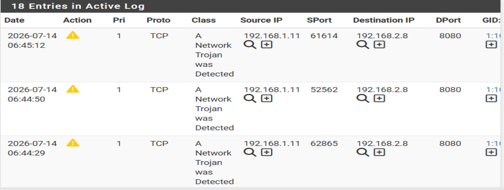
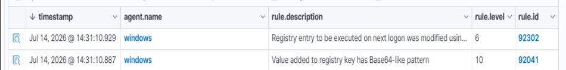
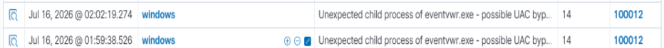
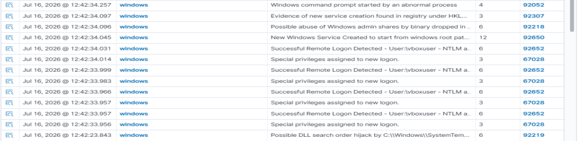
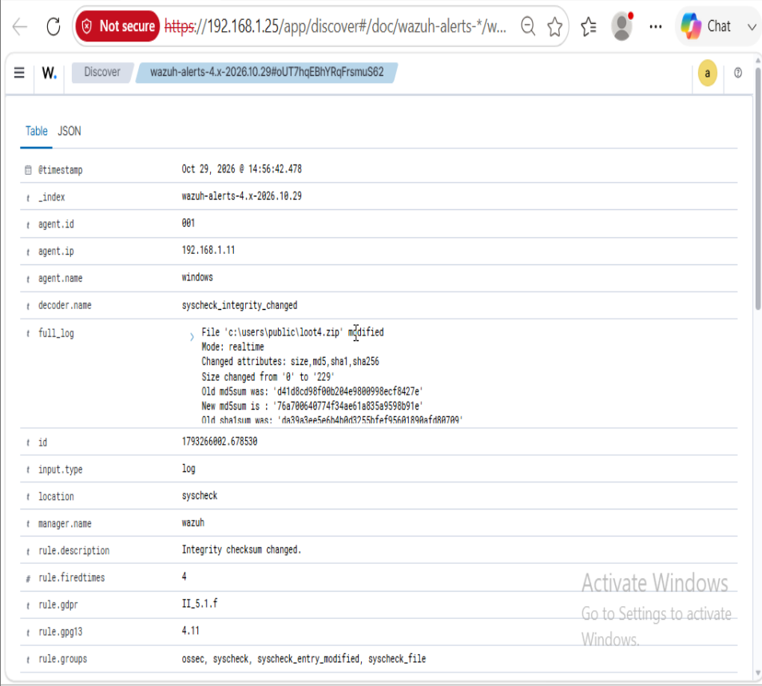
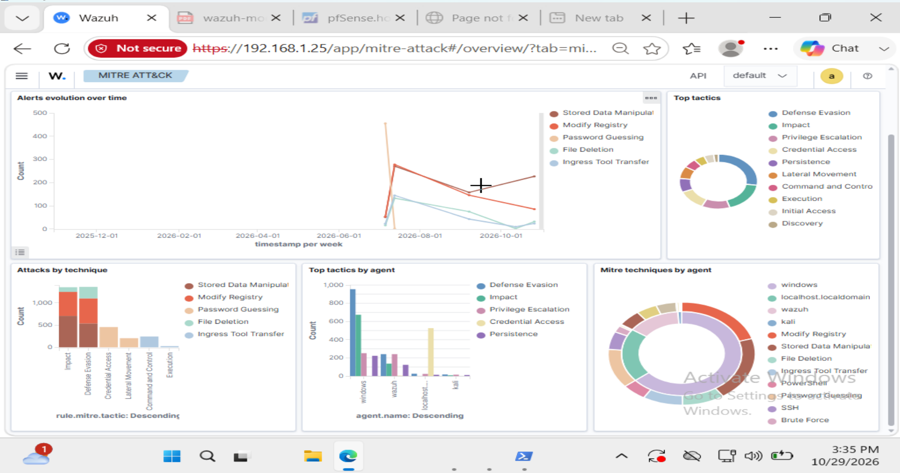

# SOC Home Lab — Attack Detection Project

A self-hosted SOC lab built in VirtualBox simulating a realistic five-stage
attack chain from initial access to data exfiltration, with detection at
every stage using Wazuh (SIEM/XDR), pfSense/Snort (network IDS), and
Windows Sysmon.

---

## Lab Topology

The lab uses two isolated subnets (LAN: 192.168.1.0/24 and OPT1: 192.168.2.0/24)
with pfSense routing between them, forcing all attack traffic through the IDS.

- Kali (Attacker): 192.168.2.8 — OPT1 subnet
- pfSense (Gateway + Snort): 192.168.1.1 / 192.168.2.1
- Windows 11 (Victim): 192.168.1.11 — LAN subnet
- Ubuntu/Wazuh (SIEM): 192.168.1.25 — LAN subnet

Key finding: a flat network makes network-layer detection completely ineffective.
Re-segmenting into two subnets was required before Snort had any visibility.

---

## Attack Chain and Detection Results

| Stage | Technique | Tool | Detected | Rule | MTTD |
|---|---|---|---|---|---|
| 1 - Initial Access | T1566.001 | msfvenom HTA + mshta.exe | Yes | Wazuh 100010 + Snort 1000001 | ~2s / ~0s |
| 2 - Persistence | T1547.001 | reg.exe Run key | Yes | Wazuh 92302 (built-in) | 2.7s |
| 3 - Privilege Escalation | T1548.002 | eventvwr.exe UAC bypass | Yes | Wazuh 100012 (custom) | less than 5s |
| 4 - Lateral Movement | T1021.002 | Impacket psexec.py | Yes | Wazuh 92650, 92218, 92052 | less than 1s |
| 5 - Exfiltration | T1560 | Compress-Archive staging | Yes | Wazuh 554 FIM | ~9s |

Detection rate: 5 out of 5 — 100%

---

## Screenshots

### Stage 1 — Initial Access detected in Wazuh (rule 100010)

### Stage 1 — .hta download detected in Snort (sid:1000001)

### Stage 2 — Persistence detected (rule 92302)

### Stage 3 — UAC Bypass detected (rule 100012)

### Stage 4 — Lateral Movement detected (6 rules firing)

### Stage 5 — Exfiltration staging detected via FIM (rule 554)

### MITRE ATT&CK Coverage Heatmap

---

## Key Findings

### 1. Network segmentation is a detection prerequisite
Snort had zero visibility on a flat subnet because packets between VMs never
transit pfSense on a flat VirtualBox internal network. Re-segmented the lab
into two subnets before detection testing was meaningful.

### 2. Wazuh Sysmon group naming is undocumented and inconsistent
Single-digit Event IDs use sysmon_event1 (no underscore).
Double-digit Event IDs use sysmon_event_13 (with underscore).
This caused silent custom rule failures until discovered by inspecting the
bundled ruleset file directly.

### 3. Telemetry beats visual observation
Stage 3 UAC bypass was misjudged as failed because no visible popup appeared.
Log review confirmed custom rule 100012 fired correctly. Always verify via
SIEM before concluding a technique succeeded or failed.

### 4. Know when built-in coverage is sufficient
Stages 2, 4, and 5 were fully detected by built-in Wazuh rules without any
custom rules. Knowing when existing tooling is sufficient is as important as
knowing how to write new rules.

### 5. Sysmon FileCreate is filtered by default
The SwiftOnSecurity Sysmon config excludes .zip creation in user directories.
Zero Event 11 entries were generated. Pivoted to Wazuh FIM (syscheck), which
operates independently of Sysmon and caught the staging activity via rule 554.

---

## Custom Detection Rules Written

Wazuh rule 100010 — mshta.exe execution (T1566.001)
Wazuh rule 100012 — eventvwr.exe unexpected child (T1548.002)
Snort sid:1000001 — .hta download over HTTP (T1566.001)

Full rule files are in the detection-rules folder.

---

## Detection Gaps Found and Fixed

| Gap | Root Cause | Fix Applied |
|---|---|---|
| Snort saw zero traffic | Flat network — packets never transited pfSense | Re-segmented into LAN/OPT1 subnets |
| Route hijacking on all VMs | Secondary NAT adapter had lower metric | Fixed per-VM via nmcli/route add/netplan |
| Rule 100010 silent failure | Regex typo (?!) instead of (?i) | Corrected and validated with wazuh-analysisd -t |
| ET Open missed .hta download | Expected coverage limitation | Custom Snort rule sid:1000001 |
| Sysmon group naming wrong | sysmon_eventN vs sysmon_event_NN undocumented | Direct ruleset file inspection |
| Stage 3 wrong conclusion | Visual assumption instead of log check | Process lesson: always verify via SIEM |
| Sysmon FileCreate filtered | Config excludes .zip in user directories | Pivoted to Wazuh FIM syscheck |
| C:\Users\Public not monitored | Pre-flight setup step missed | Added directory to syscheck block |

---

## Repository Structure

detection-rules/wazuh/ — Custom Wazuh detection rules (local_rules.xml)
detection-rules/snort/ — Custom Snort detection rules (local.rules)
report/                — Full SANS-style incident report
playbook/              — Step-by-step attack execution guide
screenshots/           — Evidence screenshots from each detection stage

---

## Tools Used

Wazuh 4.14, pfSense, Snort 2.9, Sysmon (SwiftOnSecurity config),
Metasploit Framework, Impacket, VirtualBox, Windows 11, Kali Linux,
Ubuntu 22.04

---

## Next Project

Active Directory Attack and Detection Lab — Windows Server 2022 domain
controller, simulating Kerberoasting (T1558.003), Pass-the-Hash (T1550.002),
DCSync (T1003.006), and Golden Ticket (T1558.001) with custom detection rules
for Event 4769 RC4 encryption and Event 4662 replication GUIDs.
